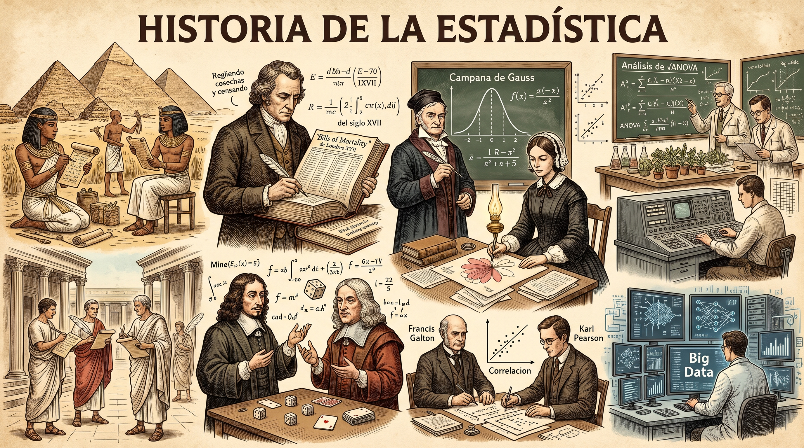
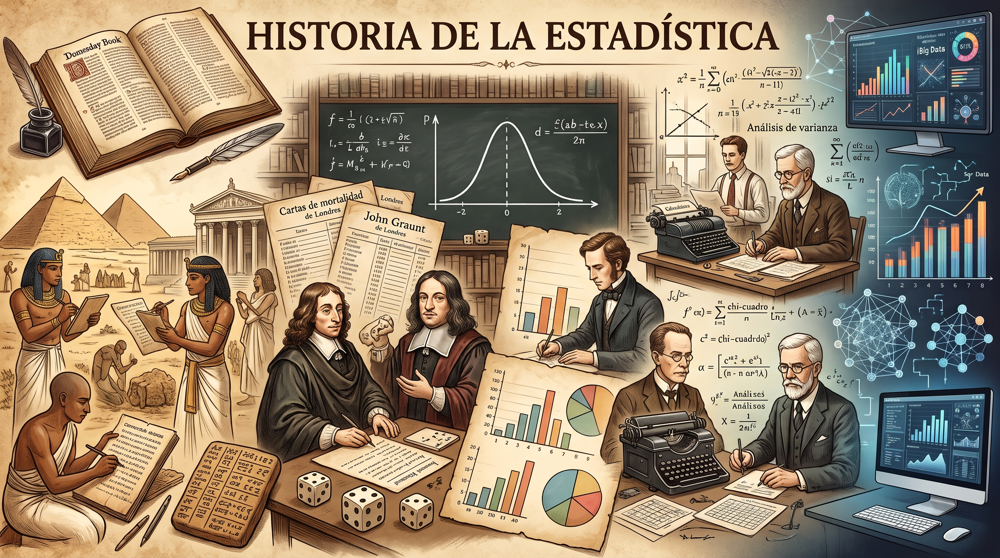
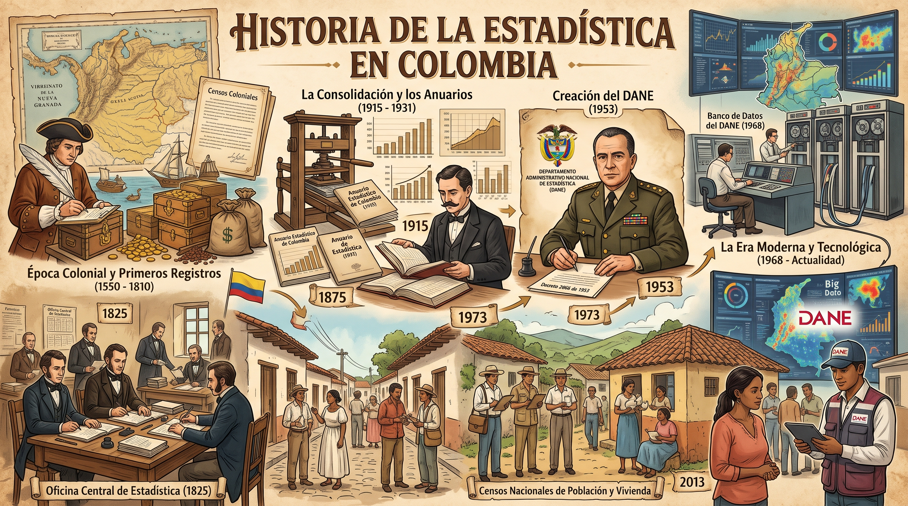
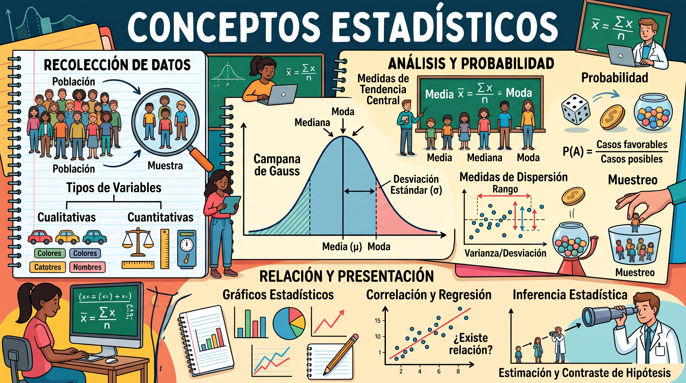

```{=html}
<div style="position:absolute; top:10px; right:10px;">

</div>
```

```{=html}
<style>
body{
  background-color:#14DEDE;
  font-size:130%;
  text-align:justify;
}
</style>
```

# .Presentación

La estadística permite convertir datos en información útil para comprender situaciones, describir fenómenos y tomar decisiones con mayor fundamento. Sus aplicaciones abarcan la administración pública, la economía, la salud, la educación, la movilidad, el comercio y muchas otras áreas.

::: callout-note
**Alcance de los ejemplos.** Las bases y resultados de R incluidos aquí son simulados con fines académicos. No representan cifras oficiales de Ibagué ni resultados reales de una entidad.
:::

# .Historia de la estadística

{fig-align="center"}

**Origen y primeros usos**

La estadística no apareció en un momento único. Surgió de necesidades prácticas de las sociedades: contar habitantes, animales y bienes; conocer la producción; registrar intercambios; y administrar recursos. El material histórico explica que sus antecedentes se reconocen en crónicas, documentos escritos y vestigios arqueológicos. Antes de existir métodos matemáticos formales, las comunidades utilizaban marcas y representaciones en piedras, madera, pieles y paredes para llevar cuentas.

Estas prácticas fueron el antecedente de los censos, los registros administrativos y la recopilación sistemática de información. Con el crecimiento de las sociedades y de los Estados, contar y organizar datos se volvió cada vez más importante para planificar tributos, disponer de recursos, organizar ejércitos y conocer la población.

**Desarrollo en las civilizaciones antiguas**

{fig-align="center"}

| Civilización o sociedad | Aporte descrito en el material | Importancia estadística |
|------------------------|------------------------|------------------------|
| Primeras comunidades | Marcas y símbolos para contar personas, animales y objetos. | Primeras formas de registro cuantitativo. |
| Babilonia (aprox. 3000 a. C.) | Tablillas de arcilla con datos de producción agrícola y bienes intercambiados. | Organización de información económica. |
| Egipto antiguo | Registros de población, renta y censos periódicos. | Administración de población y recursos. |
| Asiria | Recopilación de hechos históricos y datos sobre producción, cuentas, medicina y astronomía. | Conservación de información para la administración y el conocimiento. |
| China | Realización de censos y registros agrícolas, industriales y comerciales. | Uso de datos para conocer actividades y población. |
| Grecia | Censos con fines tributarios, sociales y militares; reflexiones sobre la importancia de la estadística para el Estado. | Relación entre información, ciudadanía y organización estatal. |
| Roma | Registros periódicos de población, nacimientos, defunciones, matrimonios, ganado, tierras y riqueza. | Consolidación de registros para administrar territorios. |
| Incas | Uso de quipus, cuerdas y nudos para registrar población y sucesos. | Sistema de registro adaptado a su organización social y territorial. |

**Edad Media y registros de población**

Durante la edad media y después de la caída del Imperio romano disminuyeron las operaciones estadísticas en Europa. Entre las excepciones se encontraban los registros de tierras vinculadas a la Iglesia y los intentos de recuperar prácticas administrativas romanas. En otros contextos, como el inca, continuaron formas propias de registro de nacimientos, defunciones y características de la población.

La Iglesia impulsó posteriormente la inscripción de nacimientos, matrimonios y defunciones. En Inglaterra, los registros de mortalidad facilitaron el análisis de la población y abrieron el camino a estudios sistemáticos sobre la frecuencia de las defunciones.

**Siglos XVII y XVIII: análisis y probabilidad**

Durante los hechos histórico se destaca varios avances:

- **John Graunt (1662):** estudió registros de mortalidad de varias décadas y elaboró estimaciones sobre defunciones y nacimientos. Su trabajo es presentado como un antecedente importante del análisis estadístico de población.
- **Gaspar Neumann (1691):** examinó registros parroquiales para contrastar la creencia de que en los años terminados en siete morían más personas. Sus resultados no respaldaron esa creencia.
- **Edmond Halley:** aplicó procedimientos de análisis demográfico al estudio de la vida humana, contribuyendo al desarrollo de tablas de mortalidad.
- **Teoría de la probabilidad:** matemáticos como Bernoulli, Maseres, Lagrange y Laplace contribuyeron a su desarrollo y ampliaron las posibilidades de aplicación de la estadística.
- **Jacques Quételet:** el material lo destaca por impulsar la aplicación de métodos estadísticos a las ciencias sociales.

**Siglos XIX, XX y actualidad**

{fig-align="center"}

Entre 1800 y 1820 se desarrollaron herramientas matemáticas relevantes, como la teoría de los errores de observación y el método de mínimos cuadrados, asociados en el material a Laplace, Gauss y Legendre. Con el tiempo, la estadística pasó de concentrarse principalmente en reunir y tabular datos a interpretar información, estudiar relaciones, estimar características de poblaciones y apoyar predicciones.

La expansión de la informática transformó el trabajo estadístico: permitió procesar grandes volúmenes de datos, aplicar métodos más complejos y producir representaciones gráficas. En la actualidad, la estadística es una herramienta transversal para estudiar fenómenos económicos, políticos, sociales, biológicos y físicos.

**Síntesis de la evolución**

La evolución puede entenderse en tres grandes etapas que aparecen en el material histórico:

1.  **Censos y recuentos:** necesidad de contar habitantes, bienes, tierras y recursos.
2.  **Descripción de conjuntos y aritmética política:** organización de registros para describir la población y la actividad económica y social.
3.  **Estadística y cálculo de probabilidades:** desarrollo de métodos para analizar datos, medir incertidumbre y realizar inferencias.

# .Conceptos

{fig-align="center"}

**¿Qué es la estadística?**

La estadística es la ciencia que recoge, organiza, presenta, analiza e interpreta datos con el propósito de obtener información y apoyar decisiones más eficaces. No se limita a calcular promedios o elaborar gráficos: también exige definir qué se quiere estudiar, cómo se recogerán los datos y qué conclusiones pueden sostenerse con ellos.

**Ramas de la estadística**

**Estadística descriptiva**

Es el conjunto de métodos que permite organizar, resumir y presentar datos de manera comprensible. Utiliza tablas, gráficos y medidas como porcentajes, promedios, medianas y medidas de dispersión.

**Ejemplo:** presentar el número mensual de viajes realizados en un sistema de bicicletas públicas durante un semestre, mediante una tabla y un gráfico.

**Estadística inferencial**

Utiliza información de una muestra para estimar, contrastar hipótesis o establecer conclusiones sobre una población. Sus resultados contienen incertidumbre, que debe evaluarse mediante herramientas estadísticas y supuestos explícitos.

**Ejemplo:** seleccionar una muestra de usuarios de un sistema de bicicletas y estimar, con un margen de error, la proporción de usuarios satisfechos del conjunto de usuarios.

| Aspecto | Descriptiva | Inferencial |
|------------------------|------------------------|------------------------|
| Propósito | Describir los datos observados. | Obtener conclusiones sobre una población a partir de una muestra. |
| Insumos | Datos de la población o de una muestra observada. | Principalmente datos muestrales y un diseño de estudio. |
| Herramientas | Tablas, gráficos, porcentajes y medidas resumen. | Estimación, intervalos de confianza, pruebas de hipótesis y modelos. |
| Alcance | No generaliza más allá de los datos analizados. | Generaliza bajo supuestos y reconoce incertidumbre. |

**Población y muestra**

- **Población:** conjunto completo de individuos, objetos o unidades de interés sobre los cuales se desea obtener información.
- **Muestra:** parte de la población seleccionada para realizar el estudio. Para que permita generalizar resultados, su selección debe responder a un diseño adecuado.
- **Censo:** procedimiento de recopilación de información de todas las unidades que integran la población definida.
- **Unidad de análisis:** elemento sobre el cual se observa o mide información; por ejemplo, una persona usuaria, una estación, un viaje o un hogar.

**Ejemplo aplicado:** si el objetivo es estudiar el uso de un sistema público de bicicletas durante un mes, la población podría estar conformada por todos los viajes registrados durante ese periodo. Una muestra sería un subconjunto de esos viajes seleccionado mediante un procedimiento definido. Si se estudian personas, debe especificarse si la unidad de análisis es cada usuario o cada viaje, porque no son equivalentes.

**Dato, variable y observación**

- **Dato:** valor registrado para una característica en una unidad de análisis; por ejemplo, 4 viajes.
- **Variable:** característica que puede tomar distintos valores entre las unidades observadas; por ejemplo, número de viajes por persona.
- **Observación:** conjunto de valores registrados para una unidad de análisis. En una base de datos, normalmente corresponde a una fila.
- **Base de datos:** organización estructurada de observaciones y variables, habitualmente en filas y columnas.

Una variable representa una característica; los valores son las respuestas o mediciones que toma dicha característica. La definición operacional debe indicar con claridad qué se mide, en quién, durante qué periodo y con qué instrumento.

**Parámetro y estadístico**

- **Parámetro:** medida numérica que describe una característica de toda la población, como la media poblacional.
- **Estadístico:** medida calculada a partir de una muestra, como la media muestral. Puede utilizarse para estimar el parámetro correspondiente.

**Instrumentos y fuentes de información**

Los materiales de clase mencionan encuestas, entrevistas, cuestionarios, observación, control de calidad y reportes de producción. La elección depende del objetivo, la población, los recursos y el tipo de dato requerido. También conviene establecer reglas para evitar registros duplicados, respuestas incompletas y errores de captura.

# Variables: concepto y clasificación según su naturaleza

**¿Qué es una variable?**

Una variable es una característica que se observa o mide en las unidades de análisis y cuyos valores pueden cambiar de una unidad a otra. La información recolectada en un estudio se almacena en variables para clasificarla, ordenarla, analizarla y presentarla.

La clasificación principal según la naturaleza distingue variables **cualitativas** y **cuantitativas**.

**Variables cualitativas o de atributo**

Describen categorías o cualidades. Sus valores no expresan una cantidad medida. Aunque algunas categorías se codifiquen con números, esos códigos no se convierten por ello en cantidades.

Ejemplos:

- Tipo de estación: fija, temporal o itinerante.
- Estado de una bicicleta: disponible, en mantenimiento o fuera de servicio.
- Tipo de vehículo: automóvil, motocicleta, bicicleta o bus.
- Estado civil o categoría de ocupación.

Las variables cualitativas pueden ser **nominales** (sin orden inherente) u **ordinales** (con categorías que sí tienen orden).

**Variables cuantitativas**

Expresan cantidades numéricas y se obtienen mediante conteo o medición. Se clasifican en:

**Cuantitativas discretas**

Representan resultados de conteos y suelen tomar valores enteros. Entre dos valores consecutivos no suelen existir valores intermedios válidos para el fenómeno contado.

Ejemplos: número de viajes realizados, número de bicicletas disponibles, número de usuarios atendidos o número de estaciones en funcionamiento.

**Cuantitativas continuas**

Representan mediciones que, en principio, pueden tomar cualquier valor dentro de un intervalo, incluidos decimales, dependiendo de la precisión del instrumento.

Ejemplos: distancia recorrida en kilómetros, duración de un viaje en minutos y segundos, velocidad, peso o temperatura.

| Naturaleza | Subtipo | ¿Qué representa? | Ejemplos |
|------------------|------------------|------------------|------------------|
| Cualitativa | Nominal u ordinal | Categorías o atributos. | Tipo de bicicleta; nivel de satisfacción. |
| Cuantitativa | Discreta | Conteos. | Número de viajes; cantidad de estaciones. |
| Cuantitativa | Continua | Mediciones. | Distancia; duración; velocidad. |

::: callout-important
**No confunda código con cantidad.** Si una encuesta codifica el tipo de estación como 1 = fija, 2 = temporal y 3 = itinerante, la variable continúa siendo cualitativa nominal. No tiene sentido calcular que la estación 3 es "mayor" que la estación 1.
:::

**Escalas o niveles de medición**

El nivel de medición indica qué tipo de información contiene una variable y qué comparaciones y operaciones tienen sentido. Los cuatro niveles presentados en el material son nominal, ordinal, intervalo y razón.

**Nivel nominal**

Agrupa categorías sin un orden natural. Los valores permiten identificar y clasificar, y pueden contarse las frecuencias de cada categoría.

**Ejemplos:** tipo de estación, marca de bicicleta, barrio, color o estado de una bicicleta. El orden en que se presenten las categorías es convencional.

**Análisis apropiados:** frecuencias, porcentajes, moda y tablas de contingencia. No se deben interpretar diferencias ni promedios de códigos asignados a categorías.

**Nivel ordinal**

Agrupa categorías que tienen un orden, pero las distancias entre una categoría y otra no necesariamente son iguales o conocidas.

**Ejemplos:** nivel de satisfacción (muy bajo, bajo, medio, alto, muy alto); nivel educativo; prioridad de atención (baja, media, alta).

**Análisis apropiados:** frecuencias, porcentajes, moda, mediana y medidas basadas en rangos. No debe suponerse que la distancia entre "bajo" y "medio" es igual a la distancia entre "alto" y "muy alto".

**Nivel de intervalo**

Es una escala numérica en la que las diferencias entre valores son interpretables y comparables, pero el cero es convencional y no representa ausencia de la característica. Por eso, las razones entre valores no suelen tener interpretación sustantiva.

**Ejemplo clásico:** temperatura expresada en grados Celsius. Una temperatura de 20 °C no significa que haya el doble de calor que a 10 °C.

**Análisis apropiados:** diferencias, medias y desviaciones, de acuerdo con el diseño y los supuestos del análisis. No es adecuado interpretar cocientes como si existiera cero absoluto.

**Nivel de razón**

Tiene las propiedades de intervalo y, además, un cero absoluto que representa ausencia de la cantidad medida. Permite interpretar tanto diferencias como razones.

**Ejemplos:** número de viajes, distancia recorrida, tiempo de viaje, peso, ingresos y cantidad de bicicletas disponibles. Cero viajes significa ausencia de viajes; 10 viajes son el doble de 5 viajes en el mismo periodo y bajo la misma definición.

**Cuadro comparativo de los niveles**

| Nivel | ¿Clasifica? | ¿Ordena? | ¿Diferencias comparables? | ¿Cero absoluto? | Ejemplo |
|------------|-----------:|-----------:|-----------:|-----------:|------------|
| Nominal | Sí | No | No | No aplica | Tipo de estación |
| Ordinal | Sí | Sí | No necesariamente | No aplica | Satisfacción |
| Intervalo | Sí | Sí | Sí | No | Temperatura en °C |
| Razón | Sí | Sí | Sí | Sí | Distancia recorrida |

**Relación entre naturaleza y escala**

La naturaleza y la escala se complementan, pero no son exactamente la misma clasificación:

- Las variables cualitativas suelen medirse en escala nominal u ordinal.
- Las variables cuantitativas suelen medirse en escala de intervalo o razón.
- Una codificación numérica no cambia la naturaleza de una variable cualitativa.
- La clasificación depende de cómo se definió y midió la característica, no solamente del aspecto de los datos almacenados.

**Aplicación práctica con R**

R es un entorno de programación orientado al análisis estadístico y la visualización de datos. A continuación, se construye una base ficticia para practicar la clasificación de variables y algunas operaciones descriptivas.

**Crear una base de datos de ejemplo**

```{r}
# Datos simulados para fines de aprendizaje
movilidad <- data.frame(
  usuario = 1:8,
  tipo_usuario = c("Estudiante", "Trabajador", "Estudiante", "Visitante",
                   "Trabajador", "Estudiante", "Visitante", "Trabajador"),
  satisfaccion = c("Alta", "Media", "Muy alta", "Baja",
                   "Alta", "Media", "Muy alta", "Alta"),
  viajes_mes = c(8, 12, 5, 2, 15, 7, 3, 10),
  distancia_km = c(12.5, 20.2, 7.8, 3.1, 26.4, 11.0, 4.7, 18.3),
  duracion_min = c(42.5, 61.0, 28.2, 14.4, 72.3, 35.0, 19.5, 55.6),
  temperatura_C = c(24.1, 25.0, 23.8, 26.2, 24.7, 23.5, 25.4, 24.3)
)

knitr::kable(movilidad, caption = "Base simulada de usuarios y viajes")
```

**Identificar la estructura y los tipos de dato**

```{r}
str(movilidad)
summary(movilidad)
```

En R, una variable cualitativa puede almacenarse como texto (`character`) o como factor (`factor`). Una variable cuantitativa suele almacenarse como `integer` o `numeric`. El tipo de almacenamiento ayuda, pero no sustituye la definición conceptual y el nivel de medición.

**Definir las variables categóricas como factores**

```{r}
movilidad$tipo_usuario <- factor(movilidad$tipo_usuario)
movilidad$satisfaccion <- factor(
  movilidad$satisfaccion,
  levels = c("Baja", "Media", "Alta", "Muy alta"),
  ordered = TRUE
)

str(movilidad)
```

La variable `tipo_usuario` es nominal, mientras que `satisfaccion` es ordinal. El uso de `ordered = TRUE` registra el orden de las categorías; no afirma que las distancias entre ellas sean iguales.

**Resumen descriptivo**

```{r}
# Frecuencias de variables cualitativas
frecuencia_tipo <- table(movilidad$tipo_usuario)
frecuencia_satisfaccion <- table(movilidad$satisfaccion)

frecuencia_tipo
frecuencia_satisfaccion

# Medidas resumen de variables cuantitativas
summary(movilidad[c("viajes_mes", "distancia_km", "duracion_min", "temperatura_C")])
```

**Visualizar los datos**

```{r}
# Gráfico de barras: variable cualitativa nominal
barplot(frecuencia_tipo,
        main = "Usuarios por tipo",
        xlab = "Tipo de usuario",
        ylab = "Frecuencia",
        col = "steelblue")
```

```{r}
# Histograma: variable cuantitativa
hist(movilidad$distancia_km,
     main = "Distribución de distancias recorridas",
     xlab = "Distancia (km)",
     ylab = "Frecuencia",
     col = "lightblue",
     border = "white")
```

```{r}
# Medidas de tendencia central y dispersión
mean(movilidad$viajes_mes)
median(movilidad$viajes_mes)
sd(movilidad$viajes_mes)
```

**Clasificación de las variables del ejemplo**

| Variable | Naturaleza | Subtipo o escala | Justificación |
|------------------|------------------|------------------|------------------|
| `usuario` | Identificador | Nominal | El número identifica a cada registro; no mide una cantidad. |
| `tipo_usuario` | Cualitativa | Nominal | Categorías sin orden natural. |
| `satisfaccion` | Cualitativa | Ordinal | Categorías ordenables. |
| `viajes_mes` | Cuantitativa | Discreta, razón | Es un conteo y el cero indica ningún viaje. |
| `distancia_km` | Cuantitativa | Continua, razón | Es una medición con cero absoluto. |
| `duracion_min` | Cuantitativa | Continua, razón | Mide tiempo transcurrido; cero significa duración nula. |
| `temperatura_C` | Cuantitativa | Continua, intervalo | Las diferencias son interpretables, pero 0 °C no indica ausencia de temperatura. |

**Ejemplo orientado a la administración pública**

Supóngase que una alcaldía desea evaluar el funcionamiento de un programa de movilidad activa. Antes de recolectar datos debe formular el objetivo y definir las unidades de análisis, el periodo, las variables y los instrumentos.

| Variable propuesta | Definición operacional | Naturaleza | Escala |
|------------------|------------------|------------------|------------------|
| Estado de la estación | Condición observada el día de la visita: operativa, parcial o fuera de servicio. | Cualitativa | Ordinal (según el orden funcional definido). |
| Tipo de daño | Categoría del daño identificado en la estación. | Cualitativa | Nominal |
| Número de bicicletas disponibles | Conteo de bicicletas listas para uso en el momento de la visita. | Cuantitativa discreta | Razón |
| Viajes diarios | Conteo de viajes registrados por día. | Cuantitativa discreta | Razón |
| Tiempo de viaje | Minutos transcurridos desde el inicio hasta el final del trayecto. | Cuantitativa continua | Razón |
| Distancia del trayecto | Kilómetros recorridos según el sistema de registro. | Cuantitativa continua | Razón |
| Satisfacción del usuario | Respuesta en escala: muy insatisfecho a muy satisfecho. | Cualitativa | Ordinal |
| Temperatura ambiente | Grados Celsius observados durante la medición. | Cuantitativa continua | Intervalo |

La definición precisa es importante. Por ejemplo, "viajes diarios" debe aclarar si se cuentan viajes iniciados, viajes finalizados o ambos; "usuario" debe aclarar si se cuenta a cada persona una sola vez o cada uso del sistema. Sin estas reglas, diferentes personas podrían producir cifras distintas aun observando el mismo fenómeno.

**Recomendaciones para un estudio estadístico**

1.  Formular una pregunta de investigación clara y delimitada.
2.  Definir la población, la unidad de análisis y el periodo de observación.
3.  Elaborar un diccionario de datos con nombre, definición, unidad, valores permitidos y escala de cada variable.
4.  Elegir instrumentos pertinentes: encuesta, entrevista, observación, cuestionario o registros administrativos.
5.  Establecer criterios de calidad: datos faltantes, duplicados, valores imposibles y consistencia entre variables.
6.  Seleccionar técnicas de análisis de acuerdo con la naturaleza y escala de medición.
7.  Presentar resultados con tablas y gráficos adecuados, indicando las limitaciones del estudio.
8.  Diferenciar los resultados observados de las inferencias o recomendaciones que se derivan de ellos.

**Conclusiones**

La historia de la estadística muestra un tránsito desde los recuentos básicos de población y recursos hasta métodos de análisis capaces de estudiar grandes conjuntos de información y apoyar decisiones complejas. Su desarrollo ha estado vinculado a las necesidades de organización de las sociedades, el avance de las matemáticas, la teoría de la probabilidad y la informática.

Los conceptos de población, muestra, dato, variable, parámetro y estadístico permiten estructurar correctamente una investigación. A su vez, distinguir entre estadística descriptiva e inferencial ayuda a reconocer cuándo se está describiendo la información observada y cuándo se está generalizando a una población.

La clasificación de las variables según su naturaleza (cualitativa o cuantitativa; discreta o continua) y según su escala (nominal, ordinal, intervalo o razón) es esencial para seleccionar operaciones y gráficos adecuados. Un análisis estadístico confiable comienza mucho antes de ejecutar un comando: comienza con una buena pregunta, definiciones claras y datos de calidad.

**Glosario básico**

| Término | Definición breve |
|------------------------------------|------------------------------------|
| Estadística | Ciencia que recoge, organiza, analiza e interpreta datos. |
| Población | Total de unidades de interés de un estudio. |
| Muestra | Parte de la población observada. |
| Censo | Recopilación de información de todas las unidades de la población definida. |
| Variable | Característica que puede tomar distintos valores. |
| Dato | Valor observado o registrado de una variable. |
| Estadístico | Medida calculada a partir de una muestra. |
| Parámetro | Medida que describe una característica de la población. |
| Variable cualitativa | Variable que clasifica en categorías. |
| Variable cuantitativa | Variable que expresa una cantidad numérica. |
| Discreta | Variable cuantitativa que representa conteos. |
| Continua | Variable cuantitativa que representa mediciones. |
| Nominal | Escala de categorías sin orden inherente. |
| Ordinal | Escala de categorías ordenadas. |
| Intervalo | Escala numérica con diferencias comparables y cero convencional. |
| Razón | Escala numérica con cero absoluto. |

**Fuentes y materiales de consulta**

**Materiales de clase proporcionados**

- Salgado Horta, D. (s. f.). *Historia de la Estadística* \[Material de clase recopilado\]. Archivo PDF proporcionado para esta actividad.
- Salgado Horta, D. (2026). *Estadística: Introducción - tipos de datos* \[Material de clase, período 2026-1\]. Archivo PDF proporcionado para esta actividad.
- Salgado Horta, D. (2026). *Estadística: Variables, niveles de medición* \[Material de clase, período 2026-1\]. Archivo PDF proporcionado para esta actividad.

**Nota sobre la bibliografía histórica**

El documento *Historia de la Estadística* incluye una sección de fuentes de consulta, entre ellas materiales de Fernando Valdés, Nancy Lacourly y recursos históricos educativos. La presente síntesis sigue principalmente la narración y los hitos tal como aparecen en el material de clase suministrado; no se presenta como una verificación historiográfica independiente de cada fecha o afirmación.

------------------------------------------------------------------------

**Fin del documento.**
